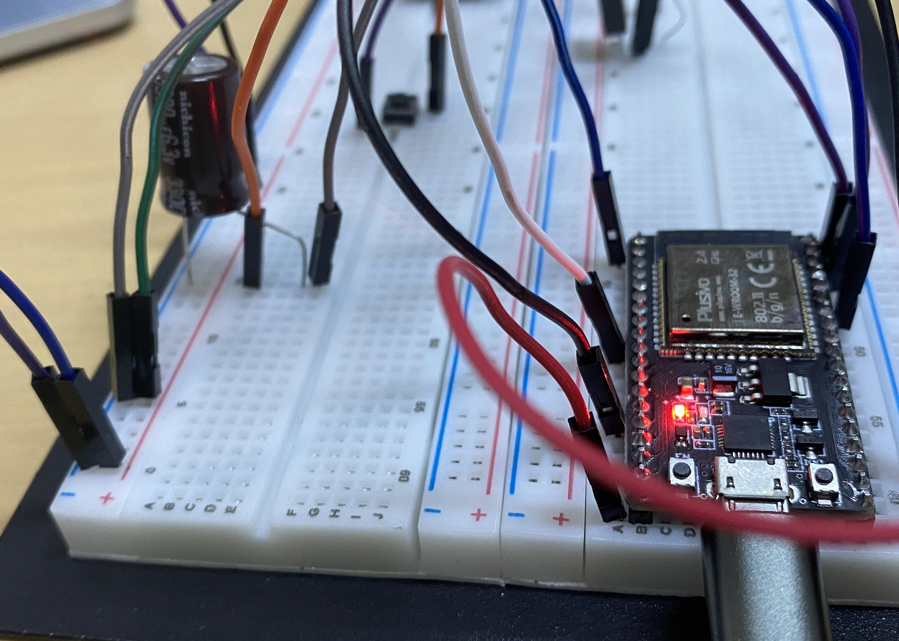
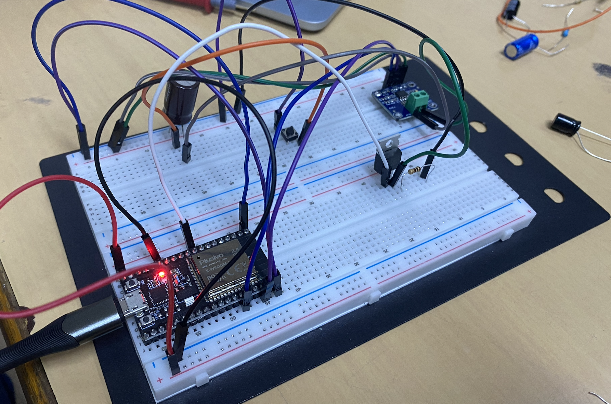
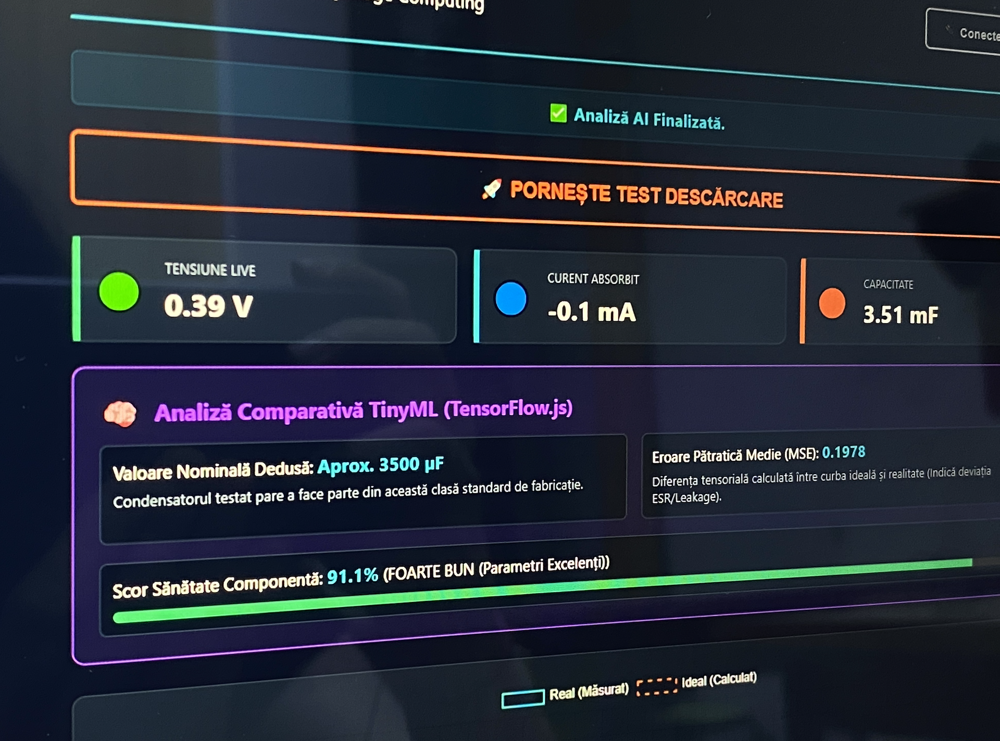

# 💻⚡️ Supercapacitor & Capacitor Analyzer using Edge AI


### 🛠️ Hardware Setup Configuration
> **Figure 1**: Asynchronous profiling connection circuit featuring the ESP32 development board and direct-drive logic-level switching line.



---

### 🧠 Real-Time TensorFlow.js Dashboard
> **Figure 2**: Live telemetry preview capturing analytical calculations, ideal curves, and component health scaling modules.



An automated, hardware-software integrated testing system designed to characterize the health and dynamic behaviors of capacitors and supercapacitors. By performing an active discharge test controlled via an **ESP32** microcontroller, the system captures high-resolution real-time voltage and current curves.
The accompanying dashboard utilizes **TensorFlow.js** to compute structural deviations from ideal models, providing a precise **State of Health (SoH)** estimation directly at the edge.

---

## Key Features ⚙️

* **Active Discharge Testing**: Programmatic control of an N-Channel Logic-Level MOSFET (`IRLZ44N`) to execute fast, clean discharge cycles.
* **High-Resolution Real-Time Telemetry**: Real-time acquisition of voltage, current, and power consumption metrics using an `INA219` sensor via an optimized 400 kHz $I^2C$ bus speed (`Wire.setClock(400000)`).
* **Mathematical Curve Integration**: Capacitance is computed locally on the microcontroller through numerical trapezoidal integration ($Q = \int I \, dt$) between defined $80\% \rightarrow 40\%$ voltage thresholds.
* **TensorFlow.js Edge AI Diagnostics**: Computes the **Mean Squared Error (MSE)** between the actual physics-based discharge curve and an ideal calculated RC model, instantly uncovering internal degradation factors like elevated ESR or dielectric leakage.
* **Dynamic Visual Dashboard**: Built-in **Web Serial API** connection interface, real-time numeric readouts, interactive multi-dataset graphs via **Chart.js**, and automated health scoring animations.

---

## Theoretical Framework

Unlike standard low-capacity capacitors that exhibit near-perfect exponential decay curves described by $V(t) = V_0 \cdot e^{-\frac{t}{\tau}}$, real-world supercapacitors operate as complex electrochemical systems. They are better modeled as distributed networks where capacitance values can shift dynamically as a function of the voltage domain: $C = f(V)$.

### 1. Internal Resistance (ESR) Computation
The hardware computes initial Equivalent Series Resistance drops right as load connection stabilizes:

$$ESR = \frac{V_{\text{gol}} - V_{\text{sarcina}}}{I_{\text{init}}}$$

### 2. Numerical Integration for Capacitance
Because constant resistance cannot be assumed under active load profiling, charge ($Q$) is evaluated using trapezoidal integration slices:

$$Q = \sum_{i=\text{idx\_high}}^{\text{idx\_low}-1} \frac{I_i + I_{i+1}}{2} \cdot \Delta t_i$$

$$C = \frac{Q}{\Delta V} = \frac{\int_{t_{\text{start}}}^{t_{\text{stop}}} I_{\text{dis}}(t) dt}{V(t_{\text{start}}) - V(t_{\text{stop}})}$$

### 3. State of Health (SoH) Optimization
TensorFlow.js processes the recorded timeline tensors to isolate component age and structural fatigue via a custom loss analysis:

$$MSE = \frac{1}{N}\sum_{k=1}^{N}(V_{\text{ideal}}[k]-V_{\text{actual}}[k])^2$$

---

## Hardware System Architecture

The hardware pipeline utilizes an efficient minimalist component layout optimized for breadboard structural integrity:

* **MCU**: ESP32 Development Board (handles microsecond task timing loops, asynchronous UART telemetry, and gate switching).
* **Sensor**: INA219 Zero-Drift Digital Current/Power Monitor (monitors up to $32\text{V}$ and $2\text{A}$ domains natively via $I^2C$).
* **Switching Element**: IRLZ44 Logic-Level N-Channel MOSFET (allows direct drive logic from ESP32 pins without a dedicated driver).
* **Power/Bus Configuration**: Dual-line $I^2C$ connection tracking alongside structural active load configurations across target test capacitor nodes.

---

## 📂 Project Structure

```bash
├── analizator.cpp      # ESP32 Arduino Core firmware (sampling engine & telemetry loops)
├── index.html          # HTML5/CSS3 Dashboard featuring Chart.js & TensorFlow.js engines
└── README.md           # Documentation
```


## Technical Setup & Deployment

### 1. Firmware Flash
1. Open `analizator.cpp` in the Arduino IDE or PlatformIO.
2. Ensure you have installed the **Adafruit INA219** library dependencies.
3. Connect your ESP32 to your workstation via USB.
4. Verify the target pinouts (`GATE_PIN 25` and native $I^2C$ mapping).
5. Flash the sketch to your board at a standard $115200\text{ bps}$ upload speed.

### 2. Dashboard Deployment
1. Open the `index.html` file natively within any modern web browser supporting the Web Serial API (e.g., Google Chrome or Microsoft Edge).
2. Click the `🔌 Conectează ESP32` button in the dashboard header.
3. Select the matching operational COM port from your system's device prompts.
4. Make sure your target supercapacitor is charged, and trigger a cycle using `🚀 PORNEȘTE TEST DESCĂRCARE`.

---
## Aknowledgements

This work was developed for SCSS (Sesiunea de Comunicări Științifice Studențești) 2026, incorporating AI‑based tools to support the prototyping process.